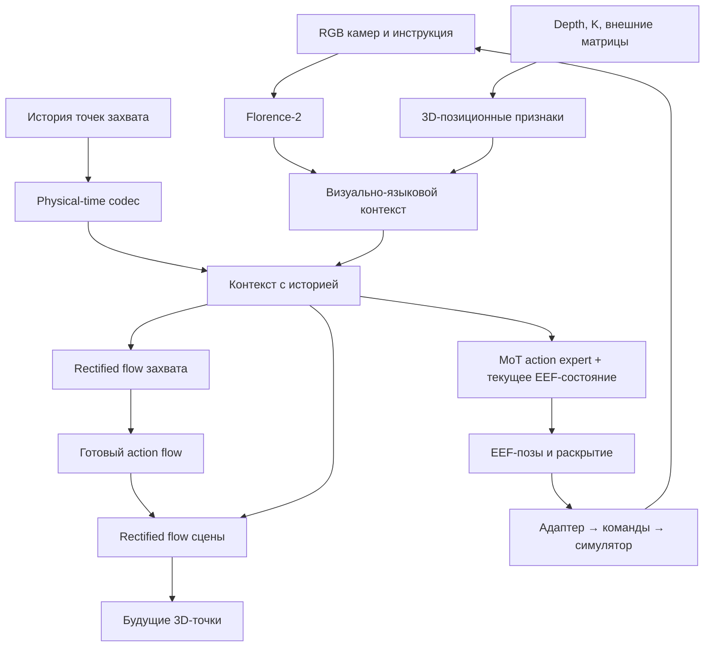

# UNITAS: прогноз движения и управление в LIBERO

Я воспроизвёл опубликованный инференс UNITAS на двух штатных RGB-D-примерах и проверил две готовые policy в LIBERO при обычном и уменьшенном освещении. Все четыре исходные серии дали 10/10; две дополнительные многоэтапные задачи также выполнены 10/10. Серия с физическим толчком кружки на подходе дала 9/10: единственный отказ — опрокинутая толчком кружка, которую policy не смогла захватить заново в пределах лимита. В метрической проверке движения ящика SceneFlow улучшил конечную ошибку относительно неподвижного прогноза, но добавил дрейф статическому фону. Задержка policy на T4/FP32 превышает длительность исполняемого блока действий. Обучение и дообучение не проводились.

## 1. Архитектура и путь данных

UNITAS связывает наблюдения, движение захвата и движение сцены в общей метрической системе. **Action flow** — траектории фиксированных точек захвата; **scene flow** — траектории query-точек окружения; **action chunk** — исполняемые EEF-позы и раскрытие захвата. Это три разных выхода. Конструкция описана в [статье, разделы 3.3–3.5](https://arxiv.org/html/2610.12099v1#S3); ниже разобран проверенный код.

**Признаки и 3D.** `Florence2VLMEncoder` кодирует все виды общим vision tower. Токены основного изображения объединяются с текстовыми embeddings и проходят двунаправленный языковой encoder; дополнительные виды передаются как отдельные визуальные признаки. `image_hw_to_world_points` масштабирует K к обработанному изображению, восстанавливает точки из depth вдоль camera z и переводит их в систему модели. Центры пикселей — `(u+0.5,v+0.5)`. В декодере признаки проецируются в общую ширину, дополняются 3D-позиционными embeddings и RoPE. При отсутствии надёжной depth frustum router взвешивает кандидатов вдоль калиброванного луча. Реализация: [florence.py](src/unitas/models/encoders/florence.py), [model.py](src/unitas/models/model.py), [position_encoding.py](src/unitas/models/position_encoding.py).

**Траектория как токен.** `FlowChunkCodec` получает смещения `[B,T,N,3]`, применяет MLP и временную FiLM-модуляцию с физическим временем `t=k/fps`. Маскированная сумма по времени с нормировкой `sqrt(H)` даёт `[B,N,C]`: один латент на целую траекторию точки. Декодер считывает его в нужные моменты времени и прибавляет смещения к исходному XYZ. Пространственный якорь остаётся исходной точкой. [flow_codec.py](src/unitas/models/flow_codec.py).

**Flow matching.** Обучающая цель статьи для чистого выхода y и гауссовского шума ε: `yτ=(1−τ)ε+τy`, целевая скорость `y−ε`. Проверенный inference начинает с шума и интегрирует предсказанное поле скорости: `z←z+vθ(z,τ)/K`, то есть явный Эйлер за K=10 шагов. Для point flow это нормированный латент, для EEF — поля команды. Время генерации τ отличается от физического времени траектории. [decoder.py](src/unitas/models/decoder.py).

**Направления внимания.** Point-dynamics transformer обрабатывает наблюдения, историю, шумные и готовые траектории. Захват читает контекст и собственную группу токенов. Scene-токены читают контекст, готовый action flow и друг друга; шумный action flow для них закрыт. Отдельный `MoTActionHead` на каждом слое получает observation/language KV основной ветви, собственное текущее EEF-состояние и шумные команды. Визуальные KV контекстуализированы совместно с историей; её токены напрямую в action expert не передаются. Контекстные KV кэшируются. В проверенном `Policy.act` action flow также вычисляется, однако будущие point flows не подаются в EEF-ветвь. [mot_action_head.py](src/unitas/models/mot_action_head.py), [policy.py](src/unitas/inference/policy.py).

| Тензор | Форма | Смысл |
|---|---|---|
| История point flow | `[B,T_hist,N_g,3]` | Смещения соответствующих точек захвата |
| Латент point flow | `[B,N,C]` | Одна траектория на токен |
| Query XYZ | `[B,N_s,3]` | Начальные точки сцены в метрах |
| MoT action | `[B,H,20]` | Два слота по 10 полей: XYZ, rotation-6D, раскрытие; отсутствующая рука маскируется |
| `scene` в NPZ | `[H_s+1,N_s,3]` | Начальный кадр и будущее, идентичность точек сохранена |
| `gripper` в NPZ | `[H_g+1,N_g,3]` | Начальные и будущие точки захвата |

В SceneFlow наблюдение обрабатывается один раз: сначала генерируются захват и EEF, затем сцена порциями точек. Viser проигрывает готовый NPZ. В policy-контуре команды исполняются в MuJoCo, и после блока действий поступает новое наблюдение.

## 2. SceneFlow на двух RGB-D-примерах

Оба опыта используют SceneFlow-checkpoint, Florence-2-large, 10 шагов генерации, порции по 256 точек и seeds 42/210921. Оборудование — Colab T4/FP32. Время включает загрузку модели и сохранение результата.

| Пример | Камеры | Точки сцены / захвата | Будущее | Полный запуск |
|---|---:|---:|---|---:|
| RoboTwin: подъём кастрюли | 3 | 45 989 / 40 | 20 шагов, 15 Гц, 1,33 с | 241,70 с |
| LIBERO: кружка на тарелку | 2 | 41 801 / 20 | 20 шагов, 20 Гц, 1 с | 252,78 с |

**RoboTwin.** Вход `robotwin_7c59d8eb33_0088.npz`, инструкция «Hold the cylindrical kitchenpot with both arms». Три вида 224×224 и история двух захватов задают исходную сцену. Выход `scene` — `[21,45989,3]`, `gripper` — `[21,40,3]`. Использованы исходные внешние матрицы без перецентрирования; физическое начало системы исторического файла отдельно не документировано.

Кастрюля поднимается вместе с захватами, корпус и ручки остаются узнаваемыми, фон визуально почти неподвижен. Под объектом открывается пустота: выход перемещает наблюдавшиеся точки, а закрытая поверхность стола отсутствует в исходном облаке. [Запись в Viser](outputs/stage1/robotwin_7c59d8eb33_0088/media/%D0%97%D0%B0%D0%BF%D0%B8%D1%81%D1%8C%202026-11-11%20152442.mp4).

**LIBERO.** Вход `libero_3d040e000e_0077.npz`, инструкция «Put the white mug on the plate». Камеры — общая и на запястье. Начальные query-точки совпадают с входом. После проверки совмещения с RGB-D те же индексы спроецированы на шагах 0/10/20. Начальная маска учитывает кадр и depth; будущая окклюзия по ней не определяется. [Проверки проекций](outputs/stage2/libero_3d040e000e_0077/projections-20261112/verification.json).

Кружка и захват движутся согласованно, без очевидного грубого распада формы. Фон проекций — начальное RGB, включая неподвижный для рисунка ракурс камеры на запястье. В разведочно выбранной области стола из 26 151 точки медиана конечного смещения — 0,714 мм, 95-й перцентиль — 0,961 мм: прогноз даёт малый дрейф статического фона. [Запись прогноза](outputs/stage2/libero_3d040e000e_0077/media/%D0%97%D0%B0%D0%BF%D0%B8%D1%81%D1%8C%202026-11-11%20185459.mp4).

**Вывод:** инференс работает на двух готовых форматах наблюдений и даёт правдоподобное короткое движение. Для метрической ошибки нужен будущий 3D-эталон; в этих NPZ его нет. Смещения фона описывают прогноз, ADE/FDE здесь не вычислялись.

### Метрическая проверка на симуляторной RGB-D-записи

Из первого эпизода task8 выбраны два окна после 50 и 100 управляющих действий, до просмотра ошибок прогноза. Для каждого восстановлены история робота, RGB-D и калибровка. Сегментация MuJoCo задаёт принадлежность точек телам; выбрано до 128 видимых пиксельных точек на не-роботическое тело (seed42), всего 1161 и 1116 точек. Их локальные координаты сохраняются, будущие соответствия восстанавливаются по позам тел.

Модель получает только историю до якоря и генерирует прогноз на 20 шагов при 20 Гц. Тот же EEF-чанк исполняется без перепланирования; его фактическое продолжение образует эталон. Начальные точки совпадают с прогнозом с допуском 10 мкм. Оценивается весь путь «прогноз + исполнение», включая ошибку слежения контроллера.

ADE — среднее 3D-расстояние по видимым парам точка–время, FDE — по видимым точкам последнего кадра; начальный кадр исключён. Движущаяся группа имеет максимальное эталонное смещение более 1 см. Видимость определяется истинными будущими камерами, попаданием в кадр, положительной глубиной и согласованием с depth до 1 см. Сравнение — те же точки, оставленные в начальном положении.

| Окно / группа | Точек исходных / видимых в финале | ADE UNITAS, мм | FDE UNITAS, мм | ADE без движения, мм | FDE без движения, мм |
|---|---:|---:|---:|---:|---:|
| 50 / все | 1161 / 980 | 1,172 | 3,369 | 0,967 | 5,299 |
| 50 / движущиеся | 128 / 121 | 5,750 | 22,177 | 8,651 | 42,921 |
| 100 / все | 1116 / 1061 | 0,549 | 0,590 | <0,001 | <0,001 |
| 100 / движущиеся | 0 / 0 | — | — | — | — |

В ADE учтены соответственно 22 045, 2 463 и 21 303 валидных пары. Полные метрики, включая все геометрические соответствия без фильтра будущей видимости: [окно 50](outputs/stage5/window050/metrics.json), [окно 100](outputs/stage5/window100/metrics.json). [Протокол и правила](docs/scene-metrics-protocol.md).

В окне 50 движется верхний ящик: Moving FDE уменьшилась с 42,9 до 22,2 мм. Средняя ADE по всей выборке немного хуже неподвижного прогноза из-за дрейфа статического фона. В окне 100 исполняемый чанк не сдвинул поверхности сцены; модель добавила примерно 0,55 мм средней ошибки. Пустая moving-группа сохранена как отсутствующее измерение. Ошибки относятся к двум фиксированным окнам одного эпизода и выбранной совокупности точек.

## 3. Замкнутое управление в LIBERO

Задача — `libero_90/task72`, «put the white mug on the plate». Каждая серия использует состояния 0–9, client seed 42, sampling seed 160484, 10 шагов генерации, 10 settle-шагов и лимит 800 действий. Пробный эпизод сохранён отдельно. Finetuned использует историю/прогноз 20/20 шагов, scratch — 30/30 при 20 Гц.

Policy получает RGB-D двух камер 256×256, калибровку, состояние, историю и инструкцию. Адаптер переводит EEF-позы из системы базы в мировую, ориентацию — в axis-angle и формирует абсолютный `OSC_POSE`: `[x,y,z,rx,ry,rz,g]`. `g=−1` открывает захват, `g=+1` закрывает. Исполняются первые 10 действий — 0,5 с, затем выполняется перепланирование. Ограничители шага адаптера равны `None`; история передаётся, несмотря на `zero_vector` у отдельных conditioning-полей.

При уменьшенном свете ambient/diffuse/specular двух именованных источников умножены на 0,5, headlight сохранён. Средняя RGB-интенсивность в контрольном состоянии упала примерно на 21%: 67,78→53,57 для общей камеры и 74,64→58,82 для камеры на запястье. Геометрия, depth, физика и начальные состояния совпадают.

Успех — `env.check_success()`, SR — доля успешных эпизодов. Предикат `(On porcelain_mug_1 plate_1)` требует контакта, достаточной высоты начала системы тела кружки и XY-расстояния между началами систем тел менее 3 см. Отпускание захвата и отвод руки в критерий не входят.

| Веса / свет | Успехи | Среднее число действий | Запросы | Среднее Policy.act, с | Медиана, с |
|---|---:|---:|---:|---:|---:|
| Finetuned / обычный | 10/10 | 144,8 | 148 | 1,657 | 1,470 |
| Finetuned / уменьшенный | 10/10 | 141,8 | 146 | 1,686 | 1,489 |
| Scratch / обычный | 10/10 | 140,7 | 145 | 1,726 | 1,489 |
| Scratch / уменьшенный | 10/10 | 133,3 | 139 | 1,639 | 1,457 |

Действия не включают settle. Синхронизированный `Policy.act` включает подготовку входа и преобразование выхода; HTTP round-trip сохранён отдельно. Ошибок запросов нет. [Полная сводка](outputs/stage3/scratch/comparison.json).

Обе конфигурации решили задачу во всех десяти состояниях при умеренном изменении света. Достигнут потолок SR; для выявления границы работоспособности нужна более сильная проверка условий. Медианная задержка около 1,5 с превышает блок исполнения 0,5 с: на T4/FP32 симулятор ждёт модель.

Выполнение из состояния 0: [обычный свет](outputs/stage3/baseline/libero_90_task72_episode000.mp4), [уменьшенный свет](outputs/stage3/dim_light/libero_90_task72_episode000.mp4). Записи свободного ракурса из восстановленного реплея: [обычный свет](outputs/stage3/baseline/media/episode000-viewer.mp4) ([отрывок](outputs/stage3/baseline/media/episode000-viewer-excerpt.mp4)), [уменьшенный свет](outputs/stage3/dim_light/media/episode000-viewer.mp4) ([отрывок](outputs/stage3/dim_light/media/episode000-viewer-excerpt.mp4)). Финальное состояние включено в запись MuJoCo и рисунок. Особенности времени MP4 описаны в приложении.

## 4. Ограничения и дальнейшая проверка

Policy-выборка охватывает одну задачу и десять повторяющихся начальных состояний. Разные горизонты и отдельные сессии finetuned/scratch не позволяют выделить причинный эффект предобучения или небольшую разницу скорости. В SceneFlow оцениваются наблюдавшиеся точки: скрытые поверхности не достраиваются, точность контактов без эталона не установлена.

Дополнительная проверка охватывает перенос стопки мисок (task63) и открытие ящика с последующим размещением миски (task8). Все серии сохраняются полностью; параметры заданы в [протоколе](docs/stress-protocol.md). Точная вставка книги и выбор похожих объектов остаются направлениями продолжения при наличии времени.

Первая новая серия, **task63**, завершена: **10/10**, в среднем 209,2 действия (198–250), 214 запросов, среднее `Policy.act` 1,629 с, медиана 1,494 с. Несмотря на многоэтапность, эта задача на выбранных состояниях не выявила отказов. В дополнительной проверке эпизода 0 цель сохранилась после открытия захвата и секунды удержания конечной TCP-позы (20/20 контрольных шагов). [Полные исходы task63](outputs/stage3/stress/task063-stack-transfer/summary.json). Запись эпизода 0: [отрывок](outputs/stage3/stress/task063-stack-transfer/media/task063-episode000-excerpt.mp4), [полная версия](outputs/stage3/stress/task063-stack-transfer/media/task063-episode000.mp4) — постановка стопки мисок в лоток.

Серия **task8** также дала **10/10**: в среднем 195,2 действия (190–203), 200 запросов, среднее `Policy.act` 1,639 с, медиана 1,506 с. Открытие ящика с последующим размещением миски на этих состояниях выполнено без ошибок запросов. [Полные исходы task8](outputs/stage3/stress/task008-drawer-bowl/summary.json). Запись эпизода 0: [отрывок](outputs/stage3/stress/task008-drawer-bowl/media/task008-episode000-excerpt.mp4), [полная версия](outputs/stage3/stress/task008-drawer-bowl/media/task008-episode000.mp4) — открытие ящика шкафа и постановка миски. Эти две дополнительные задачи не выявили отказов.

Третья целевая серия, **task072-push040**, вносит физическое возмущение: тот же task72 и состояния 0–9, к кружке на подходе приложена сила 0,4 Н по мировой оси X на управляющих шагах 60–62 (0,15 с). Параметры толчка откалиброваны до прогонов; амплитуды 1–2 Н выбрасывают кружку со стола и не подходят. Результат — **9/10**: в девяти состояниях задача решена вместе с возмущением, состояние 0 завершилось отказом на лимите 800 действий. [Команды и параметры серии](outputs/stage3/stress/task072-push040/run.json), [сводка симулятора](outputs/stage3/stress/task072-push040/libero_90_summary.json).

| Условие | Успехи | Среднее число действий | Запросы | Среднее Policy.act, с | Медиана, с |
|---|---:|---:|---:|---:|---:|
| Без возмущения (baseline) | 10/10 | 144,8 | 148 | 1,657 | 1,470 |
| Толчок 0,4 Н на подходе | 9/10 | 245,6 (130–800) | 249 | 1,639 | 1,504 |

Восемь успешных эпизодов с толчком уложились в 130–152 действия — на уровне серии без возмущения; эпизод 1 завершился за 507 действий.

**Разбор отказа (эпизод 0).** Возмущение пришлось на фазу подхода при открытом захвате (t=3,55 с): кружка опрокинулась на бок — наклон 90° уже к t≈5 с, смещение ~12 см. Опрокинулась и соседняя красная кружка (смещение 5,3 см, наклон 84°) от столкновения с целевой; коробка шоколадного пудинга не пострадала. В эпизоде 1 при том же толчке захват закрылся к моменту возмущения: наклон целевой кружки не превысил 15°, постановка завершена к t≈8 с, успех на 507 действиях; при этом коробка пудинга была сдвинута на ~19 см (осталась лежать плашмя) — посторонний эффект, не входящий в критерий успеха. В эпизоде 0 повторные попытки схватить лежащую кружку восстановления не дали: контакты захвата с кружкой повторялись окнами вплоть до t≈40 с, но устойчивого удержания и переноса не было; контакта кружки с тарелкой не возникло ни разу, XY-расстояние до тарелки не опускалось ниже 18,8 см. Наблюдение по [отрывку эпизода 0](outputs/stage3/stress/task072-push040/media/episode000-push-failure-excerpt.mp4) ([полная запись](outputs/stage3/stress/task072-push040/media/episode000-push-failure.mp4)) и [отрывку эпизода 1](outputs/stage3/stress/task072-push040/media/episode001-push-success-excerpt.mp4) ([полная запись](outputs/stage3/stress/task072-push040/media/episode001-push-success.mp4)) согласуется с состояниями. Различие исходов при одинаковом возмущении определяется тем, установился ли захват к моменту толчка; это наблюдение на одном начальном состоянии, а не распределение вероятности отказа. Численный разбор по состояниям и контактам: [эпизод 0](outputs/stage3/stress/task072-push040/diagnostics/episode000/summary.json), [эпизод 1](outputs/stage3/stress/task072-push040/diagnostics/episode001/summary.json).

## Приложение: опыт с обычным RGB-видео

Дополнительно проверена подготовка входа из записи зелёной кружки высотой 11 см и человеческой руки. Это RGB-видео с оценённой геометрией. Инструкция «Move the mug.» и история перед границей 6,0 с зафиксированы до просмотра отложенной следующей секунды.

Depth оценена на сетке 64×36 и увеличена до 224×224 ближайшим соседом; K и плоскость стола также предположены. Из 441 положений анатомических точек 418 отмечены как предположенные. Вход содержит 32 190 точек сцены и 20 условных точек пальцев; домен `libero` задаёт Panda, поэтому представление руки с ним не согласовано.

Грубая depth уже на входе создаёт полосы и фрагменты при повороте. Модель приняла формат и выдала 20 будущих шагов при 20 Гц: медианное смещение условного захвата — 8,44 мм, всего облака — 0,56 мм; 231 точка сместилась более чем на 5 мм, максимум — 60,58 мм. [Сводка запуска](outputs/stage4/cup-002/run-summary.json).

В отложенной секунде кружка почти неподвижна, как и основная масса предсказанных точек. Последний RGB относится к 0,95 с, прогноз — к 1,00 с. [Отложенное видео](media_processing/prepared/cup-001/heldout/future.mp4), [Viser](outputs/stage4/cup-002/media/videos/%D0%97%D0%B0%D0%BF%D0%B8%D1%81%D1%8C%202026-11-12%20173020.mp4).

Инженерный итог — проверен приём пользовательского формата. Для оценки динамики ручная геометрия оказалась слабым выбором: её ошибка смешивается с ошибкой модели. Для метрического опыта нужны измеренная depth и будущие соответствия; RGB-опыт не заменяет два штатных RGB-D-примера выше.

## Воспроизведение

Оборудование исходных запусков — Tesla T4, FP32 с отключённым BF16-autocast. Версии: Python 3.10, PyTorch 2.5.1+cu121, Transformers 4.57.1, NumPy 1.26.4, MuJoCo 3.2.3, robosuite 1.4.0. Ревизии исходников и весов, хеши, команды запуска и все 40 эпизодов собраны в [приложении](docs/reproducibility.md). Числовые результаты и крупные файлы находятся локально в `outputs/` и `checkpoints/`; в Git они игнорируются.
