# UNITAS: прогноз движения и управление в LIBERO

Я воспроизвёл опубликованный инференс UNITAS на двух штатных RGB-D-примерах и проверил две готовые policy в LIBERO при обычном и уменьшенном освещении. Все четыре исходные серии дали 10/10; две дополнительные многоэтапные задачи также выполнены 10/10. Серия с физическим толчком кружки на подходе дала 9/10: единственный отказ — опрокинутая толчком кружка, которую policy не смогла захватить заново в пределах лимита. В метрической проверке движения ящика SceneFlow улучшил конечную ошибку относительно неподвижного прогноза, но добавил дрейф статическому фону. Задержка policy на T4/FP32 превышает длительность исполняемого блока действий. Обучение и дообучение не проводились.

## 1. Архитектура и путь данных

UNITAS связывает наблюдения, движение захвата и движение сцены в общей метрической системе. **Action flow** — траектории фиксированных точек захвата; **scene flow** — траектории query-точек окружения; **action chunk** — исполняемые EEF-позы и раскрытие захвата. Это три разных выхода. Конструкция описана в [статье, разделы 3.3–3.5](https://arxiv.org/html/2610.12099v1#S3); ниже разобран проверенный код.

**Признаки и 3D.** Все виды камер кодируются общей Vision-частью Florence-2: главный кадр — вместе с текстом инструкции, дополнительные виды — отдельными визуальными признаками. Точки сцены восстанавливаются из depth через матрицу камеры и переводятся в единую метрическую систему модели. В декодере признаки дополняются 3D-позиционными векторами и поворотными кодами позиций (RoPE); где глубина ненадёжна, маршрутизатор выбирает кандидата вдоль калиброванного луча камеры. Код: [florence.py](src/unitas/models/encoders/florence.py), [model.py](src/unitas/models/model.py), [position_encoding.py](src/unitas/models/position_encoding.py).

**Траектория как токен.** Траектория каждой точки сжимается в один латент: смещения по времени проходят через небольшую сеть с временной модуляцией (физическое время t=k/fps) и суммируются по горизонту с нормировкой на его длину. Декодер в нужные моменты считывает латент и прибавляет смещения к исходной точке — пространственный якорь всегда остаётся исходным положением. Формы тензоров — в таблице ниже, код: [flow_codec.py](src/unitas/models/flow_codec.py).

**Flow matching.** Обучающая цель по статье: чистый выход y смешивается с гауссовским шумом ε, `yτ=(1−τ)ε+τy`, цель обучения — скорость `y−ε`. Инференс идёт в обратную сторону: от чистого шума, за K=10 шагов явного Эйлера, `z←z+vθ(z,τ)/K`. Для точек сцены z — латент траектории, для команд — сами поля. Время генерации τ не совпадает с физическим временем движения. [decoder.py](src/unitas/models/decoder.py).

**Направления внимания.** Основной трансформер обрабатывает наблюдения, историю и обе группы траекторий — шумные и готовые. Токены захвата читают общий контекст; токены сцены — контекст, уже готовый поток захвата и друг друга, но не шумный поток. Команды денойзит отдельная головка на каждом слое: она получает визуально-языковые ключи основной ветви и текущее состояние конечника. Ключи контекста кэшируются. В policy-режиме ветвь сцены не вычисляется вовсе (режим `decode_target="eef"`); что это значит для связи мира и действия — в подразделе ниже. [mot_action_head.py](src/unitas/models/mot_action_head.py), [policy.py](src/unitas/inference/policy.py).

| Тензор | Форма | Смысл |
|---|---|---|
| История point flow | `[B,T_hist,N_g,3]` | Смещения соответствующих точек захвата |
| Латент point flow | `[B,N,C]` | Одна траектория на токен |
| Query XYZ | `[B,N_s,3]` | Начальные точки сцены в метрах |
| MoT action | `[B,H,20]` | Два слота по 10 полей: XYZ, rotation-6D, раскрытие; отсутствующая рука маскируется |
| `scene` в NPZ | `[H_s+1,N_s,3]` | Начальный кадр и будущее, идентичность точек сохранена |
| `gripper` в NPZ | `[H_g+1,N_g,3]` | Начальные и будущие точки захвата |

**Главное: как предсказание мира связано с выбором действия.** В проверенном коде будущие 3D-точки сцены не участвуют в генерации команд робота. В замкнутом контуре декодер работает в режиме «только действие»: совместно денойзятся поток точек захвата и чанк команд, а ветвь сцены в этом вызове не вычисляется — поток сцены возникает только в SceneFlow-режиме, где сцена читает уже готовый поток захвата. Связь «мир → действие» идёт через общий визуально-языковой контекст: картинки, инструкция, 3D-признаки глубины и история движения захвата кодируются вместе, и ветвь команд читает этот общий контекст плюс своё текущее состояние. Предсказанные траектории объектов не входят в контроллер ни напрямую, ни через промежуточный план: сцена — вспомогательный выход (в статье — сигнал согласованности мира и действия при обучении), а не вход управления. Поэтому согласованность прогноза и исполнения проверяется отдельной метрикой (раздел 2).

**Два контура.** SceneFlow-демонстрация — одношаговый открытый прогноз: наблюдение кодируется один раз, модель генерирует движение захвата примерно на секунду вперёд и, после его завершения, движение сцены; ничего не исполняется, обратной связи нет, результат разбирается визуально и метрически постфактум. Policy-контур — замкнутый с перепланированием (receding horizon): каждый запрос получает свежее наблюдение, предсказывает чанк на 20 шагов (30 у scratch) при 20 Гц, адаптер переводит его в команды и в симулятор уходят только первые 10 (0,5 с); затем цикл повторяется с новой картинкой. Задержка одного запроса policy ~1,5–1,6 с на T4/FP32 превышает блок исполнения 0,5 с: симулятор ждёт модель, а не наоборот. Это принципиальное отличие от SceneFlow-контура, где модель никогда не видит последствий своего прогноза.

## 2. SceneFlow на двух RGB-D-примерах

Оба опыта используют SceneFlow-checkpoint, Florence-2-large, 10 шагов генерации, порции по 256 точек и seeds 42/210921. Оборудование — Colab T4/FP32. Время включает загрузку модели и сохранение результата.

| Пример | Камеры | Точки сцены / захвата | Будущее | Полный запуск |
|---|---:|---:|---|---:|
| RoboTwin: подъём кастрюли | 3 | 45 989 / 40 | 20 шагов, 15 Гц, 1,33 с | 241,70 с |
| LIBERO: кружка на тарелку | 2 | 41 801 / 20 | 20 шагов, 20 Гц, 1 с | 252,78 с |

**RoboTwin.** Вход `robotwin_7c59d8eb33_0088.npz`, инструкция «Hold the cylindrical kitchenpot with both arms». Три вида 224×224 и история двух захватов задают исходную сцену. Выход — 21 кадр (начальный плюс 20 шагов) для 45 989 точек сцены и 40 точек захвата.

**Координаты и масштаб.** Глубина, XYZ и поступательные смещения заданы в метрах в масштабе сцены 1:1. Например, медианное смещение точек захватов RoboTwin за горизонт составляет 0,118 м (11,8 см). В выходных массивах `scene` и `gripper` координаты остаются в той же системе модели, что и входные XYZ.

| Система координат | Начало и оси | Как используется |
|---|---|---|
| Камера | Оптический центр. +X вправо по изображению, +Y вниз, +Z вперёд вдоль оптической оси | Матрица `K` и глубина переводят пиксель в XYZ камеры. Внешняя матрица `extrinsic` переводит XYZ модели в камеру, её обратная — из камеры в модель |
| Модель, штатный SceneFlow NPZ | Общая система сцены, унаследованная из файла. В RoboTwin +Z направлена вверх от стола. Относительно cam0 +X имеет положительную составляющую по глубине, +Y направлена почти влево по изображению | Все три камеры RoboTwin используют одну систему. Оптический центр cam0 находится в точке (−0,031; 0,037; 0,569) м в координатах модели. Привязка нуля файла к базам роботов не указана |
| База Panda, LIBERO policy и эталон task8 | Начало и оси тела `robot0_link0` или `robot0_base` в MuJoCo | В этой системе выражены наблюдения и выходные EEF-позы модели, а также точки прогноза и эталона task8 |
| Мир LIBERO | Глобальное начало и оси сцены MuJoCo | Адаптер применяет `world_from_robot_base` к EEF-позам перед отправкой абсолютных команд контроллеру |

[Обратная проекция](src/unitas/scene_flow/io.py) · [Привязка базы](evaluation/libero/environment.py) · [Адаптер LIBERO](src/unitas/inference/adapters/libero.py)

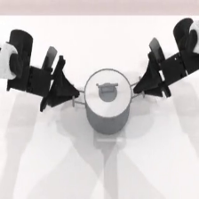
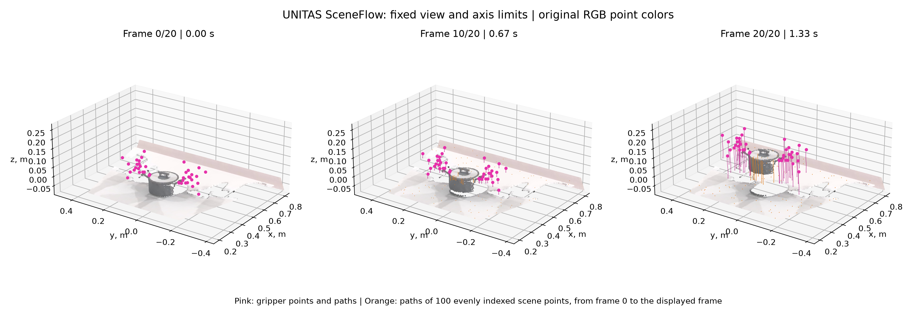

Розовым показаны 40 опорных точек двух захватов и их траектории. Оранжевым выделены траектории 100 выбранных точек сцены, остальное облако показано в исходных RGB-цветах.

Кастрюля поднимается вместе с захватами, корпус и ручки остаются узнаваемыми, фон визуально почти неподвижен. Под объектом открывается пустота: выход перемещает наблюдавшиеся точки, а закрытая поверхность стола отсутствует в исходном облаке. [Запись в Viser](docs/report-media/recordings/robotwin-viser.mp4).

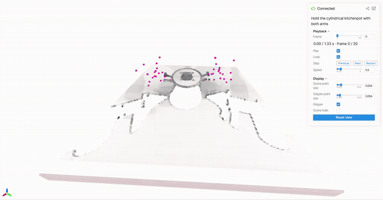

**LIBERO.** Вход `libero_3d040e000e_0077.npz`, инструкция «Put the white mug on the plate». Камеры — общая и на запястье. Начальные query-точки совпадают с входом. После проверки совмещения с RGB-D те же индексы спроецированы на шагах 0/10/20. Начальная маска учитывает кадр и depth; будущая окклюзия по ней не определяется. [Проверки проекций](docs/report-media/stage2-projection-verification.json).

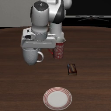
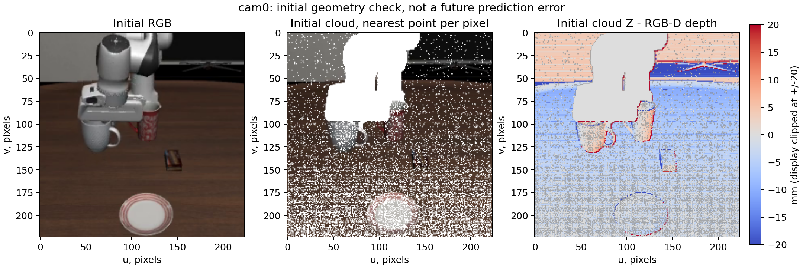
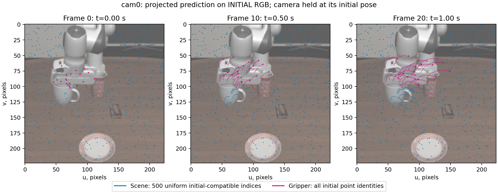
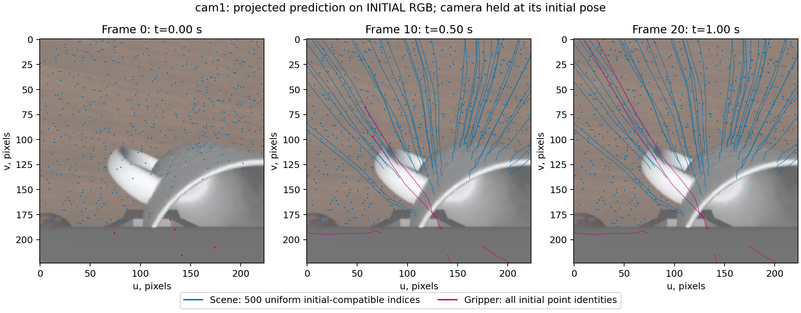

Кружка и захват движутся согласованно, без очевидного грубого распада формы. Фон проекций — начальное RGB, включая неподвижный для рисунка ракурс камеры на запястье. В разведочно выбранной области стола из 26 151 точки медиана конечного смещения — 0,714 мм, 95-й перцентиль — 0,961 мм: прогноз даёт малый дрейф статического фона. Анимация ниже собрана из сохранённого прогноза `scene_flow.npz` (движущиеся точки сцены синим, точки захвата красным): [исходная короткая запись экрана Viser](docs/report-media/recordings/libero-viser.mp4).

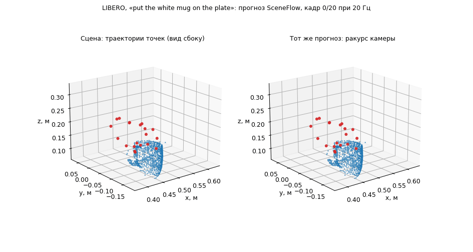

**Вывод:** инференс работает на двух готовых форматах наблюдений и даёт правдоподобное короткое движение. Для метрической ошибки нужен будущий 3D-эталон; в этих NPZ его нет. Смещения фона описывают прогноз, ADE/FDE здесь не вычислялись.

### Метрическая проверка на симуляторной RGB-D-записи

Из первого эпизода task8 выбраны два окна после 50 и 100 управляющих действий, до просмотра ошибок прогноза. Для каждого восстановлены история робота, RGB-D и калибровка. Сегментация MuJoCo задаёт принадлежность точек телам; выбрано до 128 видимых пиксельных точек на не-роботическое тело (seed42), всего 1161 и 1116 точек. Их локальные координаты сохраняются, будущие соответствия восстанавливаются по позам тел.

Модель получает только историю до якоря и генерирует прогноз на 20 шагов при 20 Гц. Тот же EEF-чанк исполняется без перепланирования и даёт наблюдаемое продолжение для эталона. Начальные точки совпадают с прогнозом с допуском 10 мкм. Такая оценка проверяет согласованность сцены с исполнением команд самой модели, включая ошибку слежения контроллера. Даже при невыполненной задаче согласованный прогноз может иметь низкую ошибку, поэтому успех управления измеряется отдельно в разделе 3.

Пусть $\hat p_{i,t}$ и $p_{i,t}$ — прогноз и эталон для точки $i$ на шаге $t$. Множество $\mathcal V$ содержит валидные пары «точка–время» на шагах $1,\ldots,T$, где $T=20$, а $\mathcal V_T=\{i\mid(i,T)\in\mathcal V\}$ содержит точки последнего кадра.

$$
\mathrm{ADE}=\frac{1}{|\mathcal V|}\sum_{(i,t)\in\mathcal V}\|\hat p_{i,t}-p_{i,t}\|_2,\qquad
\mathrm{FDE}=\frac{1}{|\mathcal V_T|}\sum_{i\in\mathcal V_T}\|\hat p_{i,T}-p_{i,T}\|_2.
$$

Без маски в $\mathcal V$ входят все валидные будущие соответствия. С маской дополнительно требуется видимость эталонной точки хотя бы в одной будущей камере: положительная глубина, попадание в кадр и согласование с depth в пределах 1 см. Движущиеся точки выделяются по максимальному эталонному смещению более 1 см на всём горизонте. Неподвижный прогноз оставляет те же точки в начальных положениях. Ошибки в таблице приведены в миллиметрах.

| Окно / группа | Маска видимости | Пар ADE | Точек FDE | ADE UNITAS | FDE UNITAS | ADE без движения | FDE без движения |
|---|---|---:|---:|---:|---:|---:|---:|
| 50 / все | Без маски | 23 220 | 1 161 | 1,178 | 3,079 | 0,959 | 4,732 |
| 50 / все | С маской | 22 045 | 980 | 1,172 | 3,369 | 0,967 | 5,299 |
| 50 / движущиеся | Без маски | 2 560 | 128 | 5,754 | 21,593 | 8,695 | 42,921 |
| 50 / движущиеся | С маской | 2 463 | 121 | 5,750 | 22,177 | 8,651 | 42,921 |
| 100 / все | Без маски | 22 320 | 1 116 | 0,549 | 0,588 | <0,001 | <0,001 |
| 100 / все | С маской | 21 303 | 1 061 | 0,549 | 0,590 | <0,001 | <0,001 |
| 100 / движущиеся | Обе версии | 0 | 0 | — | — | — | — |

Полные результаты, включая статическую группу. [Окно 50](docs/report-media/stage5-window050-metrics.json) · [Окно 100](docs/report-media/stage5-window100-metrics.json) · [Протокол расчёта](docs/scene-metrics-protocol.md)

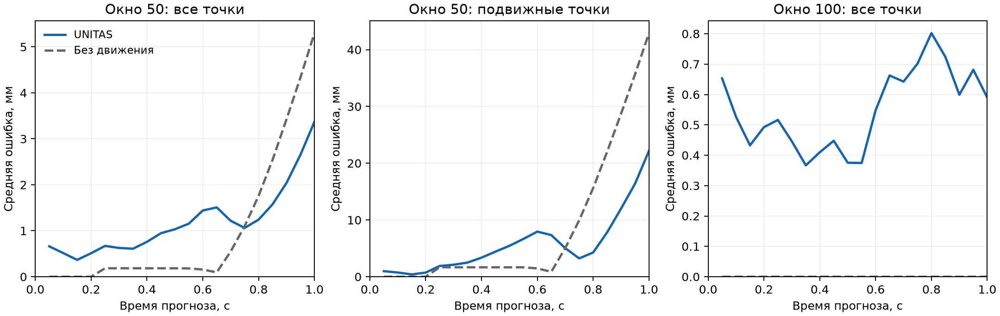

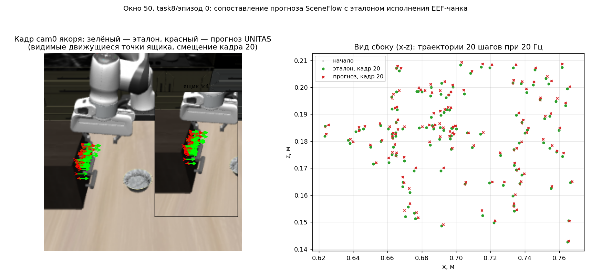

В окне 50 движется верхний ящик: Moving FDE уменьшилась с 42,9 до 22,2 мм. Средняя ADE по всей выборке немного хуже неподвижного прогноза из-за дрейфа статического фона. В окне 100 исполняемый чанк не сдвинул поверхности сцены; модель добавила примерно 0,55 мм средней ошибки. Пустая moving-группа сохранена как отсутствующее измерение. Ошибки относятся к двум фиксированным окнам одного эпизода и выбранной совокупности точек.

В окне 50 RMS-остаток после наилучшего жёсткого совмещения облака ящика с его начальной формой составил в среднем **2,38 мм**, максимум — **6,90 мм**. Эта метрика измеряет деформацию облака отдельно от ошибки перемещения. [Метрики окна 50](docs/report-media/stage5-window050-metrics.json).

## 3. Замкнутое управление в LIBERO

Задача — `libero_90/task72`, «put the white mug on the plate». Каждая серия использует состояния 0–9, client seed 42, sampling seed 160484, 10 шагов генерации, 10 settle-шагов и лимит 800 действий. Пробный эпизод сохранён отдельно. Finetuned использует историю/прогноз 20/20 шагов, scratch — 30/30 при 20 Гц.

Policy получает RGB-D двух камер 256×256, калибровку, состояние, историю и инструкцию. Адаптер переводит позы конечника из системы базы робота в мировую, ориентацию — в ось-угол и формирует абсолютную команду `OSC_POSE`: `[x,y,z,rx,ry,rz,g]`. `g=−1` открывает захват, `g=+1` закрывает. Исполняются первые 10 действий — 0,5 с, затем выполняется перепланирование. Ограничители шага адаптера отключены; часть служебных полей истории передаётся с нулевыми векторами.

При уменьшенном свете ambient/diffuse/specular двух именованных источников умножены на 0,5, headlight сохранён. Средняя RGB-интенсивность в контрольном состоянии упала примерно на 21%: 67,78→53,57 для общей камеры и 74,64→58,82 для камеры на запястье. Геометрия, depth, физика и начальные состояния совпадают.

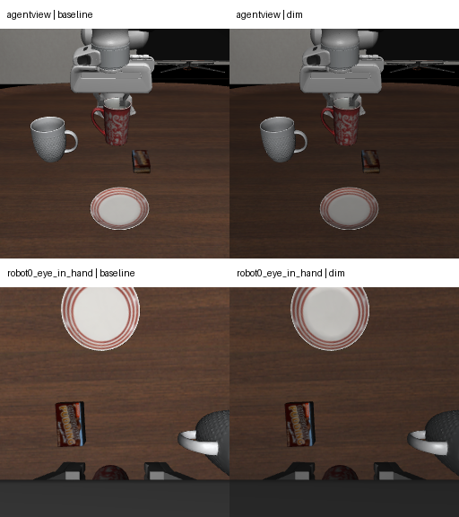

Успех — `env.check_success()`, SR — доля успешных эпизодов. Предикат `(On porcelain_mug_1 plate_1)` требует контакта, достаточной высоты начала системы тела кружки и XY-расстояния между началами систем тел менее 3 см. Отпускание захвата и отвод руки в критерий не входят.

| Веса / свет | Успехи | Среднее число действий | Запросы | Среднее Policy.act, с | Медиана, с |
|---|---:|---:|---:|---:|---:|
| Finetuned / обычный | 10/10 | 144,8 | 148 | 1,657 | 1,470 |
| Finetuned / уменьшенный | 10/10 | 141,8 | 146 | 1,686 | 1,489 |
| Scratch / обычный | 10/10 | 140,7 | 145 | 1,726 | 1,489 |
| Scratch / уменьшенный | 10/10 | 133,3 | 139 | 1,639 | 1,457 |

Действия не включают settle. Синхронизированный `Policy.act` включает подготовку входа и преобразование выхода; HTTP round-trip сохранён отдельно. Ошибок запросов нет. [Полная сводка](docs/report-media/stage3-policy-comparison.json).

Обе конфигурации решили задачу во всех десяти состояниях при умеренном изменении света. Достигнут потолок SR; для выявления границы работоспособности нужна более сильная проверка условий. Медианная задержка около 1,5 с превышает блок исполнения 0,5 с: на T4/FP32 симулятор ждёт модель.

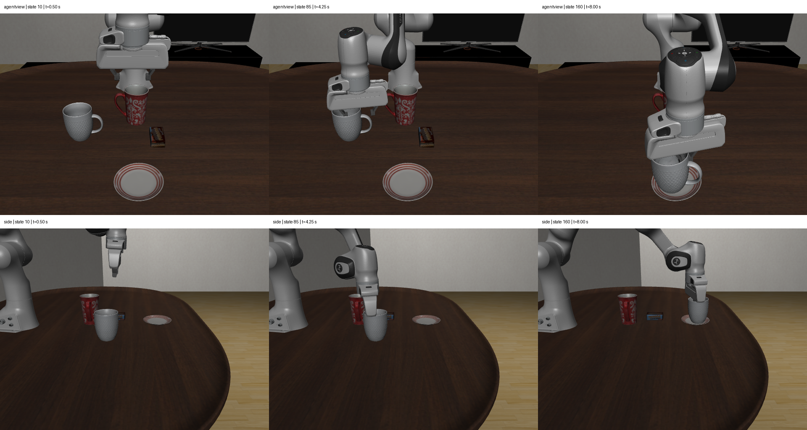

Выполнение из состояния 0: [обычный свет](docs/report-media/recordings/baseline-robotcam-episode000.mp4), [уменьшенный свет](docs/report-media/recordings/dim-light-robotcam-episode000.mp4). Записи свободного ракурса из восстановленного реплея: [обычный свет](docs/report-media/recordings/baseline-episode000-viewer.mp4) ([отрывок](docs/report-media/recordings/baseline-episode000-viewer-excerpt.mp4)), [уменьшенный свет](docs/report-media/recordings/dim-light-episode000-viewer.mp4) ([отрывок](docs/report-media/recordings/dim-light-episode000-viewer-excerpt.mp4)). Финальное состояние включено в запись MuJoCo и рисунок. Особенности времени MP4 описаны в приложении.

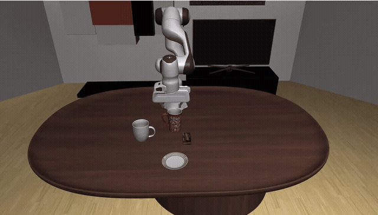
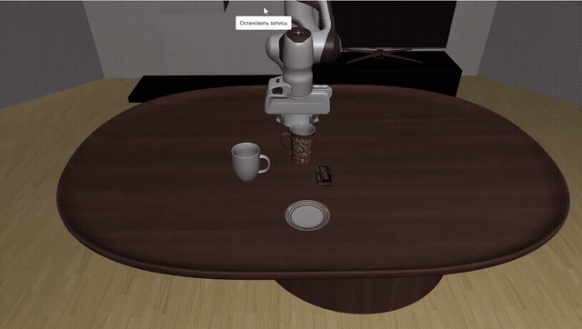

Вид робокамеры — то, что модель получает на вход (ускорено ~1,5 раза, ожидание ответа policy не показано):

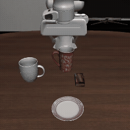

## 4. Ограничения и дальнейшая проверка

Policy-выборка охватывает одну задачу и десять повторяющихся начальных состояний. Разные горизонты и отдельные сессии finetuned/scratch не позволяют выделить причинный эффект предобучения или небольшую разницу скорости. В SceneFlow оцениваются наблюдавшиеся точки: скрытые поверхности не достраиваются, точность контактов без эталона не установлена.

Дополнительная проверка охватывает перенос стопки мисок (task63) и открытие ящика с последующим размещением миски (task8). Все серии сохраняются полностью; параметры заданы в [протоколе](docs/stress-protocol.md). Точная вставка книги и выбор похожих объектов остаются направлениями продолжения при наличии времени.

Первая новая серия, **task63**, завершена: **10/10**, в среднем 209,2 действия (198–250), 214 запросов, среднее `Policy.act` 1,629 с, медиана 1,494 с. Несмотря на многоэтапность, эта задача на выбранных состояниях не выявила отказов. В дополнительной проверке эпизода 0 цель сохранилась после открытия захвата и секунды удержания конечной TCP-позы (20/20 контрольных шагов). [Полные исходы task63](docs/report-media/task063-summary.json). Запись эпизода 0: [отрывок](docs/report-media/recordings/task063-episode000-excerpt.mp4), [полная версия](docs/report-media/recordings/task063-episode000.mp4) — постановка стопки мисок в лоток.

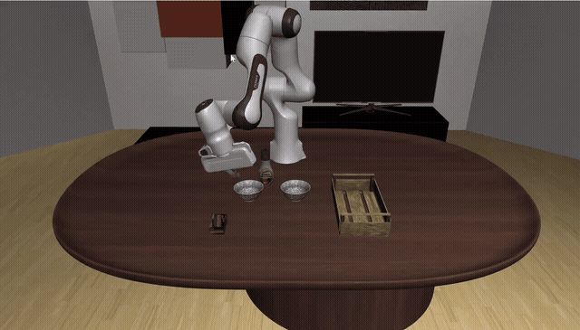

Серия **task8** также дала **10/10**: в среднем 195,2 действия (190–203), 200 запросов, среднее `Policy.act` 1,639 с, медиана 1,506 с. Открытие ящика с последующим размещением миски на этих состояниях выполнено без ошибок запросов. [Полные исходы task8](docs/report-media/task008-summary.json). Запись эпизода 0: [отрывок](docs/report-media/recordings/task008-episode000-excerpt.mp4), [полная версия](docs/report-media/recordings/task008-episode000.mp4) — открытие ящика шкафа и постановка миски. Эти две дополнительные задачи не выявили отказов.

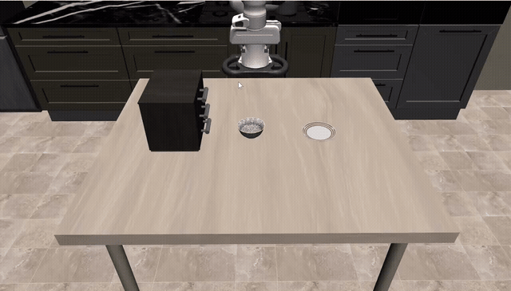

### Три парные проверки на task72

Во всех сериях использованы finetuned-веса и начальные состояния 0–9. Штатный контроль дал 10/10.

| Условие | Успех | Что показал разбор | Видео | Численные данные |
|---|---:|---|---|---|
| Боковой толчок 0,4 Н на подходе | 9/10 | В состоянии 000 кружка опрокинулась, повторные попытки захвата не восстановили удержание | [Отказ](docs/report-media/task072-push-failure.gif) · [Успех](docs/report-media/task072-push-success.gif) | [Сводка серии](docs/report-media/task72-stress/push-summary.json) |
| Тангенциальное трение пальцев о кружку снижено до 20% штатного | 10/10 | После срыва робот перехватил кружку. Число действий выросло со 150 до 229 в состоянии 002 и со 134 до 190 в состоянии 005 | [Низкое трение 002](docs/report-media/task72-stress/002-low-friction.mp4) · [Контроль 002](docs/report-media/task72-stress/002-baseline.mp4) | [Парные исходы](docs/report-media/task72-stress/low-friction-comparison.json) · [Трасса сил 002](docs/report-media/task72-stress/episode002-contact-forces.json) |
| Частичная визуальная окклюзия | 10/10 | Медиана перекрытия 25,8% в общей камере, с запястья цилиндр цель не перекрывал | [Окклюзия 001](docs/report-media/task72-stress/001-occlusion.mp4) · [Контроль 001](docs/report-media/task72-stress/001-baseline.mp4) | [Парные исходы](docs/report-media/task72-stress/occlusion-comparison.json) · [Аудит видимости и захвата](docs/report-media/task72-stress/visibility-and-grasp.json) |

**Боковой толчок.** Силу приложили по мировой оси X на управляющих шагах 60–62 (0,15 с). Амплитуду выбрали до прогонов, поскольку при 1–2 Н кружка вылетала со стола. Среднее число действий выросло со 144,8 до 245,6 с учётом отказа на лимите 800 действий. Медиана `Policy.act` составила 1,504 с при 1,470 с в контроле. [Параметры серии](docs/report-media/task72-stress/push-run.json).

Восемь успешных эпизодов с толчком уложились в 130–152 действия — на уровне серии без возмущения; эпизод 1 завершился за 507 действий.

**Разбор эпизодов 000 и 001.** Возмущение пришлось на фазу подхода при открытом захвате (t=3,55 с): кружка опрокинулась на бок — наклон 90° уже к t≈5 с, смещение ~12 см. Опрокинулась и соседняя красная кружка (смещение 5,3 см, наклон 84°) от столкновения с целевой; коробка шоколадного пудинга не пострадала. В эпизоде 1 при том же толчке захват закрылся к моменту возмущения: наклон целевой кружки не превысил 15°, первое касание тарелки произошло в 8,10 с, а предикат успеха выполнен после 507 действий; при этом коробка пудинга была сдвинута на ~19 см (осталась лежать плашмя) — посторонний эффект, не входящий в критерий успеха. В эпизоде 0 повторные попытки схватить лежащую кружку восстановления не дали: контакты захвата с кружкой повторялись окнами вплоть до t≈40 с, но устойчивого удержания и переноса не было; контакта кружки с тарелкой не возникло ни разу, XY-расстояние до тарелки не опускалось ниже 18,8 см. Наблюдение по [отрывку эпизода 0](docs/report-media/recordings/task072-episode000-push-failure-excerpt.mp4) и [отрывку эпизода 1](docs/report-media/recordings/task072-episode001-push-success-excerpt.mp4) согласуется с состояниями. В этих двух эпизодах фаза захвата в момент толчка различалась. Чтобы проверить, объясняет ли она разницу исходов, нужен отдельный контроль. Численный разбор по состояниям и контактам: [эпизод 0](docs/report-media/task72-stress/push-episode000-diagnostics.json), [эпизод 1](docs/report-media/task72-stress/push-episode001-diagnostics.json).

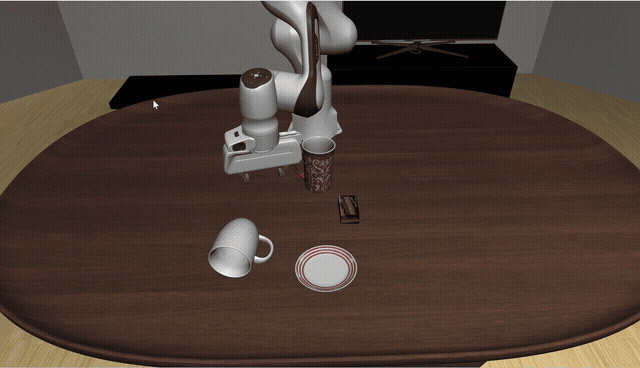
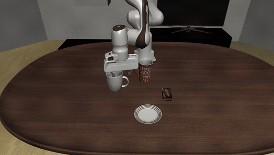

**Низкое трение, состояние 002.** В контроле кружка поднята с первой попытки. При низком трении пальцы касаются кружки с двух сторон в 4,45 с, к 5,15 с контакт теряется, а к 9,15 с кружка поднята на 2 см после перехвата. Итоговые 10/10 скрывают дополнительные действия в обоих состояниях.

| Низкое трение · 002 | Штатное трение · 002 |
|---|---|
| 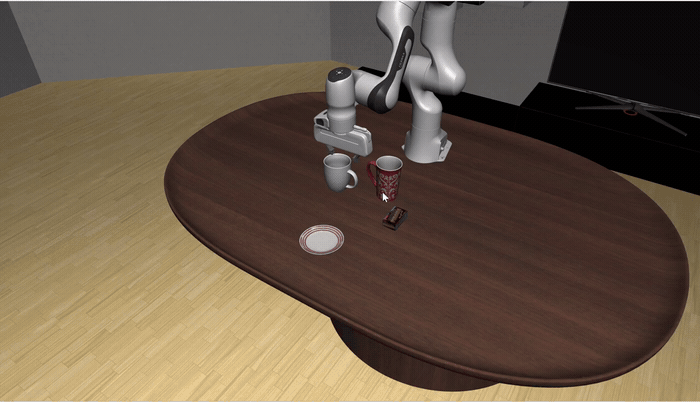 | 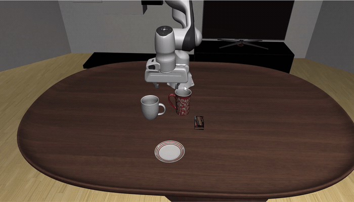 |

При повторном подходе корпус захвата прижал соседнюю красную кружку к столу. На кадре 6,70 с вертикальная сила от корпуса составила **61,0 Н вниз**, реакция стола — **62,2 Н вверх**. Силы восстановлены из сохранённых состояний MuJoCo через `mj_forward` и `mj_contactForce`. MuJoCo обновлял физику каждые 2 мс (500 Гц), а состояния сохранялись каждые 50 мс (20 Гц), поэтому 61,0 Н — максимум среди доступных кадров, и кратковременный пик силы мог быть выше. Давление и вероятность разрушения кружки неизвестны. В контроле захват соседней кружки не касался. Обе команды закрытия имели значение +1. Пиковая сумма нормальных сил на белой кружке до первого срыва составила 15,46 Н, при повторном захвате и начале подъёма — 6,08 Н. Конечный критерий засчитал оба прогона как успешные и не отразил ни перехват, ни побочный контакт.

**Окклюзия, состояние 001.** Парные GIF показывают полные записи с визуальной помехой и в штатном условии. При переносе кружка проходит сквозь синий цилиндр, поскольку его коллизии отключены. В таблице также доступны короткие MP4 с подходом. Перекрытие по маскам на 71 запросе до первой команды закрытия составило 20,7–31,9% в общей камере и 0% в камере на запястье. Во всех десяти эпизодах цель поставлена на тарелку. Замеры относятся к наблюдениям policy. Ролики записаны со свободного ракурса. Обе GIF ускорены в 1,5 раза.

| Окклюзия · 001 | Штатное условие · 001 |
|---|---|
| 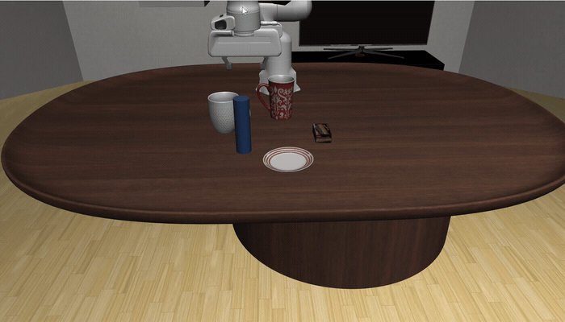 | 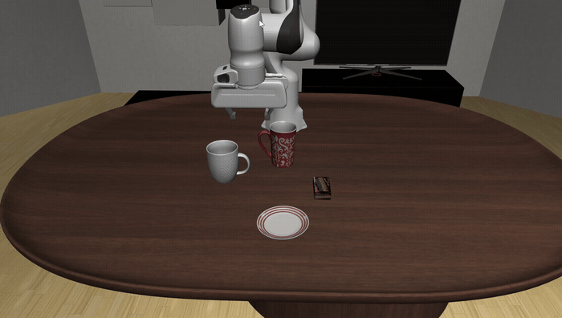 |

### Собственная RGB-сцена

Опыт с собственным RGB-видео (кружка и рука, глубина предположена) подтвердил совместимость формата. Прогноз был почти статичным: медианное конечное смещение составило **0,56 мм**, при этом **231 точка** сместилась более чем на 5 мм. Это смещения внутри прогноза. Для оценки 3D-ошибки нужны эталонные соответствия. [Сводка и материалы](docs/report-media/stage4-cup-002-summary.json).

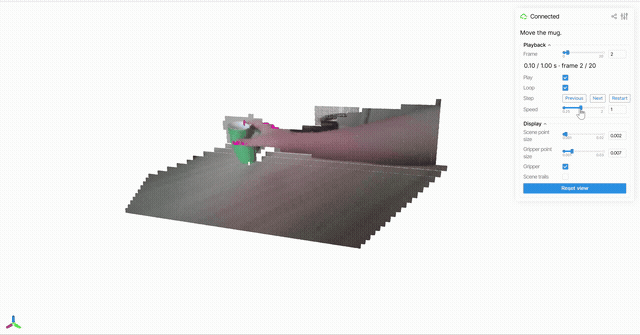

## Воспроизведение

Оборудование исходных запусков — Tesla T4, FP32 с отключённым BF16-autocast. Версии: Python 3.10, PyTorch 2.5.1+cu121, Transformers 4.57.1, NumPy 1.26.4, MuJoCo 3.2.3, robosuite 1.4.0. Ревизии исходников и весов, хеши, команды запуска и все 40 эпизодов собраны в [приложении](docs/reproducibility.md). Сводки и демонстрационные записи доступны по ссылкам выше. Полные сырые результаты хранятся локально в `outputs/`, скачанные веса — в `checkpoints/`.

Ключевые команды (из подготовленного GPU-окружения; порядок установки двух окружений — в [reproducibility.md](docs/reproducibility.md)):

Этап 1 — SceneFlow, RoboTwin:

```bash
python src/unitas/scene_flow/inference.py --checkpoint checkpoints/unitas_scene_flow.pt \
  --florence-dir checkpoints/Florence-2-large \
  --input assets/scene_flow/observations/robotwin_7c59d8eb33_0088.npz \
  --output outputs/repeat-stage1/scene_flow.npz --device cuda --steps 10 \
  --chunk-size 256 --policy-seed 42 --scene-seed 210921
```

Этап 2 — тот же запуск с входом `libero_3d040e000e_0077.npz`, затем 2D-проекции:

```bash
python src/stage2_transfer/project_prediction.py --input <входной npz> \
  --prediction <прогноз scene_flow.npz> --output-dir <каталог рисунков>
```

Этап 3 — policy в LIBERO:

```bash
python src/stage3_policy/run_evaluation.py --condition baseline --episodes 10 \
  --checkpoint checkpoints/unitas_libero_finetuned.pt \
  --output-dir outputs/repeat-policy/baseline
```

Этап 5 — метрики SceneFlow против эталона:

```bash
python src/stage5_metrics/score.py --prediction <прогноз.npz> \
  --reference <reference.npz> --output metrics.json
```
