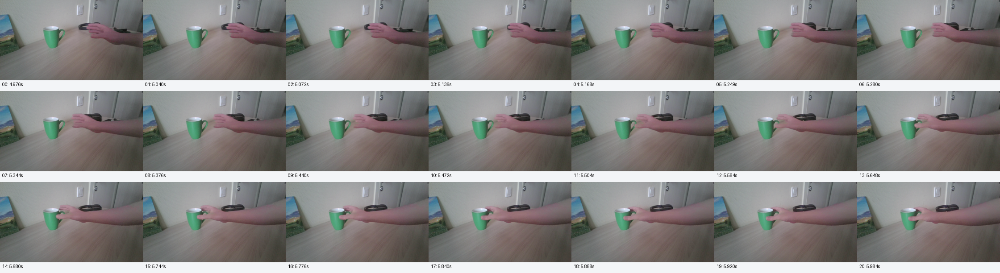
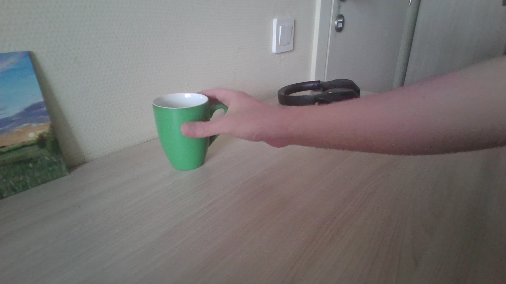
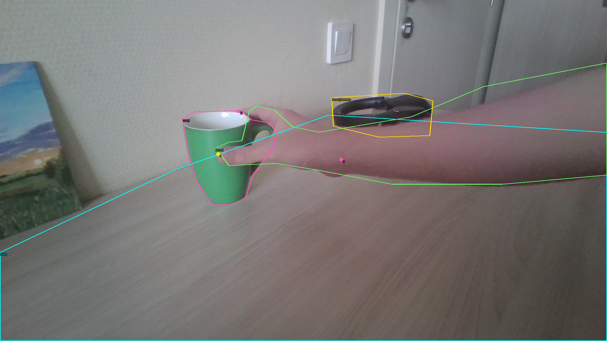
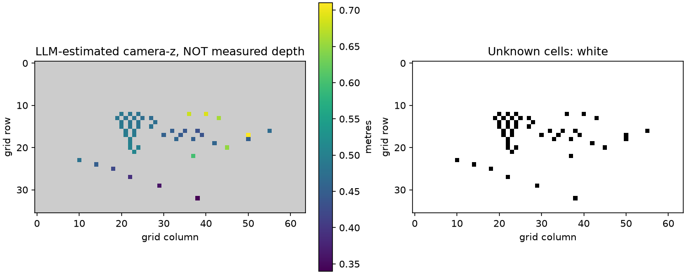
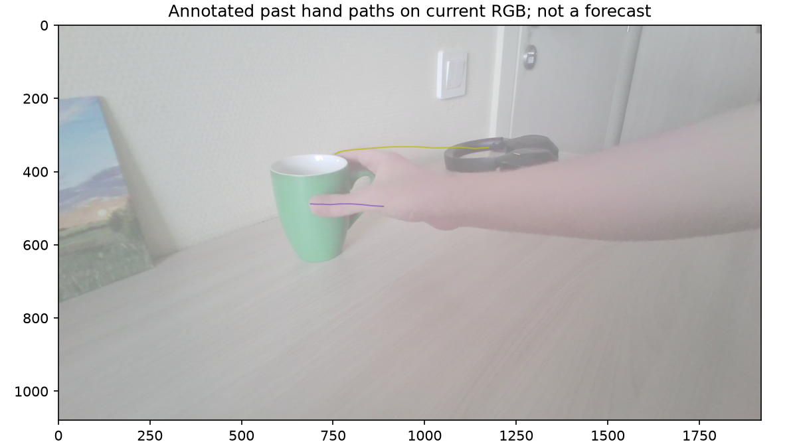

# Подготовка собственной сцены прямым анализом модели

**Статус: PACKED — EXPERIMENTAL**

> Глубина, геометрия и точки руки оценены моделью. Это не измеренный RGB-D и не эталон.

## Разрешённые исходные данные

Видео: `WIN_20261112_10_59_15_Pro.mp4`, 1920×1080; длительность 15.680 с.
Граница прогноза: **6.000 с**; вход — предшествующая секунда. История: 21 целевое состояние при 20 Гц.
Уникальных исходных кадров: 21. Реальные времена и повторы сохранены в manifest.

[Входной фрагмент без аудио](input.mp4)

<video controls src="input.mp4"></video>

Следующая секунда сохранена отдельно и не использовалась для разметки. Содержание отложенного фрагмента здесь не показывается.

## Текущий кадр и разметка

Жёлтые точки — видимые по оценке разметчика, розовые — предположенные. Даже у видимых точек глубина оценена.

| Объект | Статус | Перекрытия |
|---|---|---|
| table: столешница | visible | Кружка, рука и предметы перекрывают видимую столешницу; скрытая поверхность не размечена. |
| headphones: наушники | visible | Частично перекрыты предплечьем. |
| mug: зелёная кружка с ручкой | visible | Правая сторона кружки и ручка частично перекрыты пальцами; невидимую поверхность не достраивал. |
| hand: правая рука и предплечье | visible | Пальцы закрывают часть кружки; предплечье перекрывает наушники и столешницу. |

Маска [object-polygons.png](figures/object-polygons.png) растеризует заданные моделью полигоны; при перекрытии последний полигон записывается поверх предыдущего. Это не независимая пиксельная сегментация.

## Оценённая глубина

Сетка 64×36; увеличение до 224×224 при упаковке не добавляет измерений или деталей.

## История руки

Во входе предусмотрены 20 точек пальцев на кадр, но в этой разметке заполнены только 30 из 420 возможных записей; остальные отмечены маской отсутствия. Запястье сохранено отдельно. Человеческая рука отличается от поверхности обучающего захвата Panda. Условная EEF-поза и одно раскрытие не описывают все суставы пальцев.

## Что измерено и что предположено

| Величина | Источник |
|---|---|
| Высота кружки: 11 см | Измерение пользователя |
| RGB и временные метки | Исходное видео |
| Глубина, K, стол, точки руки, EEF | Оценки модели |
| Дисторсия отсутствует, камера неподвижна | Допущение / визуальная оценка; не инструментальная калибровка |

Команда: `Move the mug.`.

### Допущения

- Камера визуально неподвижна по фону в просмотренной секунде.
- K приблизительно выбран по перспективе; вместе с высотой кружки 0,11 м он даёт порядок глубины около 0,5 м у кружки.
- Карта camera-z заполнена лишь в отдельных визуально распознанных ячейках; соседние ячейки не интерполированы.
- Поза EEF обозначает условный центр хвата. Единичный quaternion — соглашение об ориентации осей камеры, не измеренная ориентация кисти.
- Значения open_fraction обозначают видимое приближение пальцев к кружке, не измеренный зазор захвата.

### Ограничения

- Оценка глубины и K сильно неоднозначна для одного RGB-ракурса; 0,11 м измерено только для кружки.
- Большинство анатомических точек скрыты или размыты и оставлены unknown. Отмеченные inferred 2D-позиции и все z_m являются предположениями.
- Разреженная карта глубины покрывает только выбранные ячейки; NPZ технически совместим, но полнота 3D-сцены низка.
- Человеческая рука отличается от обучающего захвата Panda; интерфейсная EEF не является роботной кинематикой.
- Отложенное будущее, 3D ADE/FDE и качество прогноза не проверялись.

## Проверки и готовность

- Depth and calibration are model estimates, not measured RGB-D
- Human joints differ from the trained Panda surface points
- Conditional EEF/opening is an interface approximation
- No independent future visibility, 3D ADE/FDE or physical calibration accuracy

Сохранён [input.npz](input.npz), 1051 query-точек; покрытие глубины 2.1%.
Максимальный остаток обратной проекции точек: 2.27e-13 пикселя. Это проверка алгебры, не точности оценок.
[Преобразования, времена и происхождение](input-provenance.json).

[Основные оценки](annotations.json) · [Манифест](manifest.json) · [Проверки](validation.json)

UNITAS не запускалась; точность будущего, ADE/FDE и успешность задачи здесь не оценивались.
