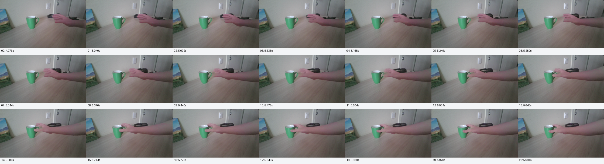
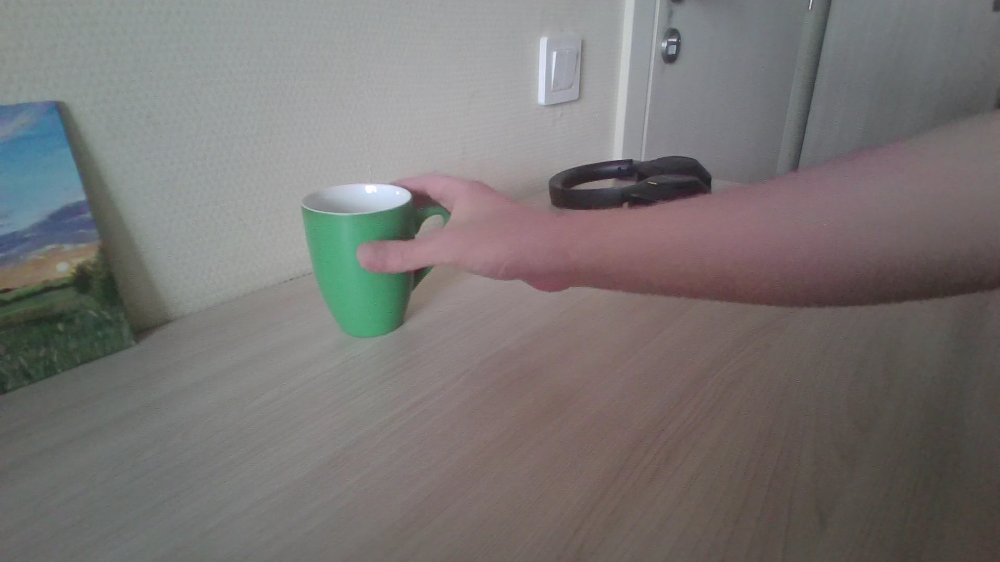
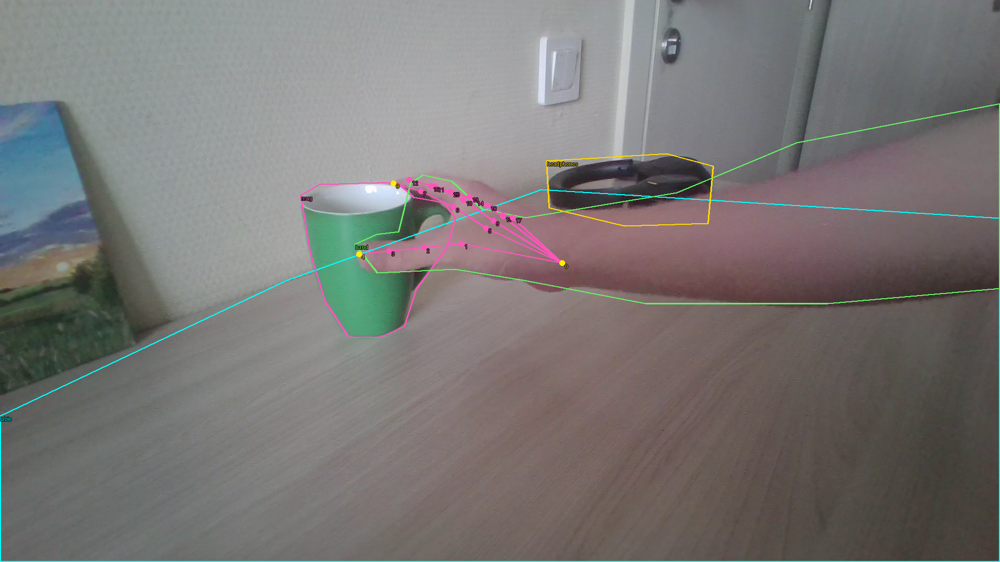
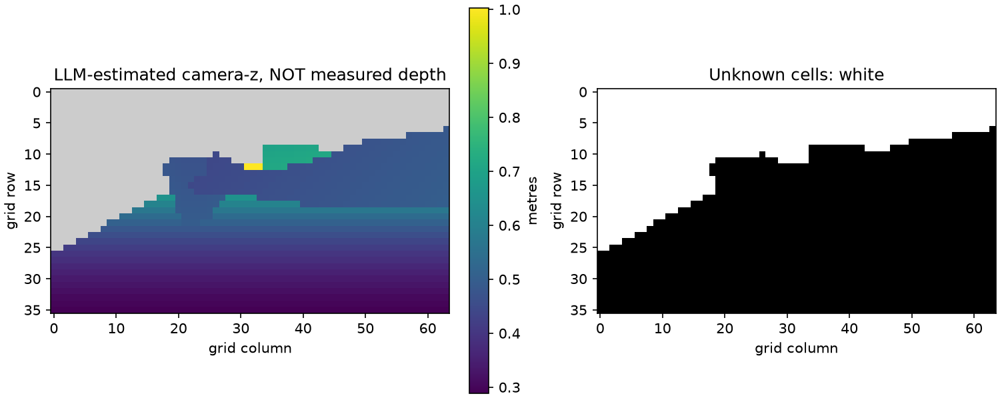
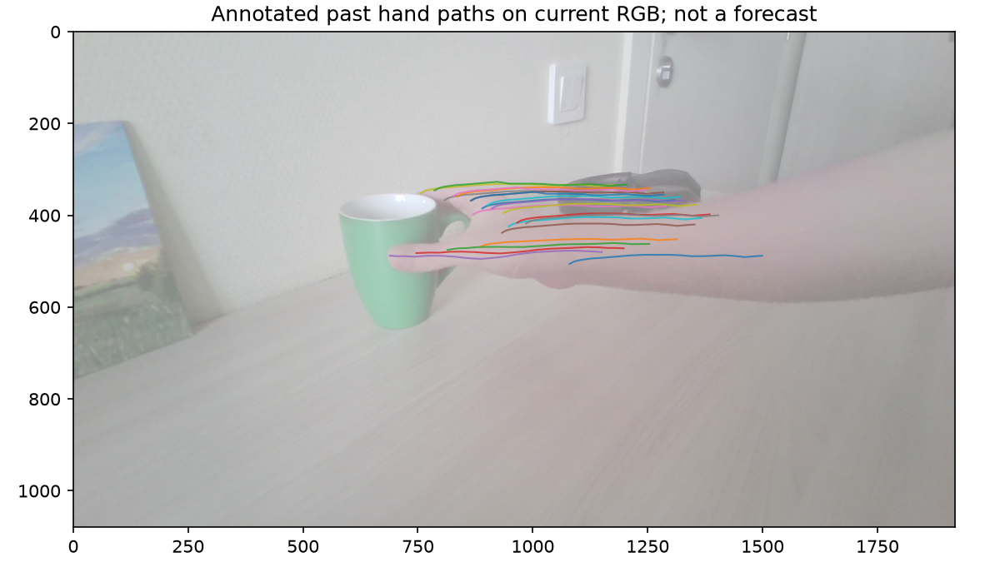
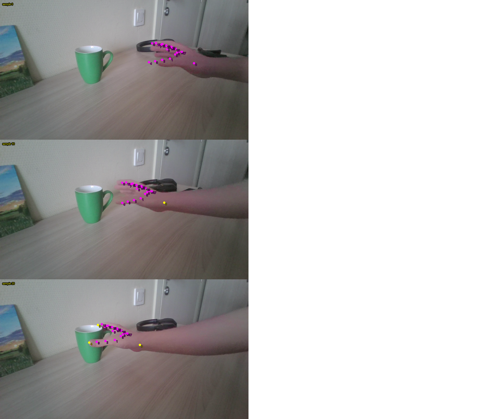

# Подготовка собственной сцены прямым анализом модели

**Статус: PACKED — EXPERIMENTAL**

> Глубина, геометрия и точки руки оценены моделью. Это не измеренный RGB-D и не эталон.

## Разрешённые исходные данные

Видео: `WIN_20261112_10_59_15_Pro.mp4`, 1920×1080; длительность 15.680 с.
Граница прогноза: **6.000 с**; вход — предшествующая секунда. История: 21 целевое состояние при 20 Гц.
Уникальных исходных кадров: 21. Реальные времена и повторы сохранены в manifest.

[Входной фрагмент без аудио](input.mp4)

<video controls src="input.mp4"></video>

Следующая секунда сохранена отдельно и не использовалась для разметки. Содержание отложенного фрагмента здесь не показывается.

## Текущий кадр и разметка

Жёлтые точки — видимые по оценке разметчика, розовые — предположенные. Даже у видимых точек глубина оценена.

| Объект | Статус | Перекрытия |
|---|---|---|
| table: столешница | visible | Кружка, рука и предметы перекрывают видимую столешницу; скрытая поверхность не размечена. |
| headphones: наушники | visible | Частично перекрыты предплечьем. |
| mug: зелёная кружка с ручкой | visible | Правая сторона кружки и ручка частично перекрыты пальцами; невидимую поверхность не достраивал. |
| hand: правая рука и предплечье | visible | Пальцы закрывают часть кружки; предплечье перекрывает наушники и столешницу. |

Маска [object-polygons.png](figures/object-polygons.png) растеризует заданные моделью полигоны; при перекрытии последний полигон записывается поверх предыдущего. Это не независимая пиксельная сегментация.

## Оценённая глубина

Сетка 64×36; увеличение до 224×224 при упаковке не добавляет измерений или деталей.

## История руки

Во вход передаются 20 точек пальцев; запястье сохранено отдельно. Человеческая рука отличается от поверхности обучающего захвата Panda. Условная EEF-поза и одно раскрытие не описывают все суставы пальцев.

## Что измерено и что предположено

| Величина | Источник |
|---|---|
| Высота кружки: 11 см | Измерение пользователя |
| RGB и временные метки | Исходное видео |
| Глубина, K, стол, точки руки, EEF | Оценки модели |
| Дисторсия отсутствует, камера неподвижна | Допущение / визуальная оценка; не инструментальная калибровка |

Команда: `Move the mug.`.

### Допущения

- Вторая попытка использует ту же историю 21 кадра и границу 6,0 с, что cup-001; будущее не просматривалось.
- K и плоскость стола согласованы с видимой высотой кружки при её измеренной высоте 0,11 м; реальная калибровка неизвестна.
- Глубина столешницы вычислена пересечением луча с оценённой плоскостью только внутри вручную размеченного полигона.
- Глубина кружки, наушников и руки интерполирована по видимым контурам и опорным оценкам, а не измерена сенсором.
- Скрытые суставы восстановлены по видимому контуру кисти и анатомической непрерывности; статус inferred не означает наблюдение.
- EEF — условный центр хвата; единичный quaternion оставлен соглашением, а не измеренной ориентацией кисти.

### Ограничения

- Монокулярный RGB не определяет единственную метрическую геометрию: ошибка K, наклона стола и формы кружки связана между собой.
- Полная глубина столешницы является геометрической экстраполяцией; особенно ненадёжны дальние и крайние области.
- Перекрытые пальцы и скрытые стороны кисти имеют высокую неопределённость; полные 21 точки являются предположением.
- Полигоны приблизительны: около краёв глубина может принадлежать соседнему объекту или фону.
- Человеческая рука и условная EEF отличаются от обучающей кинематики Panda. Техническая упаковка не подтверждает качества прогноза.
- Отложенный фрагмент, 3D ADE/FDE и физическая калибровка не проверялись.

## Проверки и готовность

- Depth and calibration are model estimates, not measured RGB-D
- Human joints differ from the trained Panda surface points
- Conditional EEF/opening is an interface approximation
- No independent future visibility, 3D ADE/FDE or physical calibration accuracy

Сохранён [input.npz](input.npz), 32190 query-точек; покрытие глубины 64.2%.
Максимальный остаток обратной проекции точек: 2.27e-13 пикселя. Это проверка алгебры, не точности оценок.
[Преобразования, времена и происхождение](input-provenance.json).

[Основные оценки](annotations.json) · [Манифест](manifest.json) · [Проверки](validation.json)

UNITAS не запускалась; точность будущего, ADE/FDE и успешность задачи здесь не оценивались.

## Самопроверка и сравнение попыток

Это новая оценка тех же 21 разрешённых кадров, граница 6,0 с сохранена. [Происхождение попытки](attempt-provenance.json) связывает её с cup-001; первое извлечение и его NPZ не изменялись. Отложенный фрагмент не открывался.

Покрытие грубой карты глубины выросло с 48/2304 (2,1%) до 1477/2304 (64,1%) ячеек. Оценены все 441 записи анатомических точек за 21 кадр, но лишь 23 помечены как видимые; остальные 418 — **inferred**. Рост покрытия отражает интерполяцию и экстраполяцию из визуальных оценок, а не новые измерения.

[Численные проверки](self-check.json): проекция высоты кружки 0,11 м составляет 293,4 пикселя при приблизительно 295 пикселях на кадре; максимальный шаг условной EEF между соседними состояниями — 0,0169 м. Эти проверки показывают внутреннюю согласованность чисел, а не независимую точность.

Наибольший риск ошибки — скрытые фаланги, граница руки и кружки, дальняя столешница, неизвестные реальные K и дисторсия. Единичный quaternion EEF — соглашение интерфейса; ориентация кисти не измерена. Глубина вне размеченных полигонов остаётся неизвестной.
