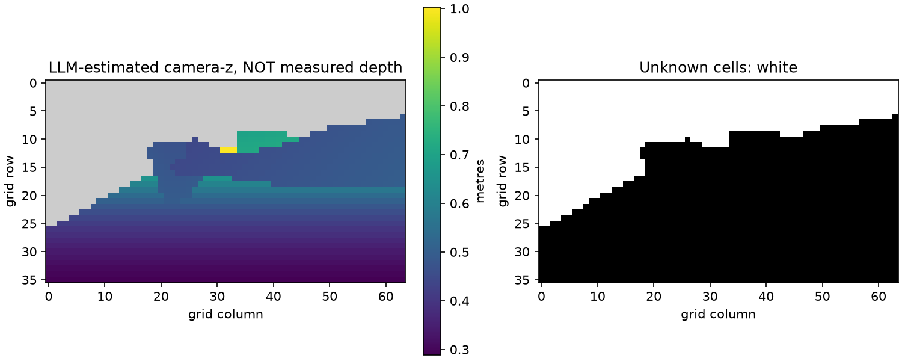
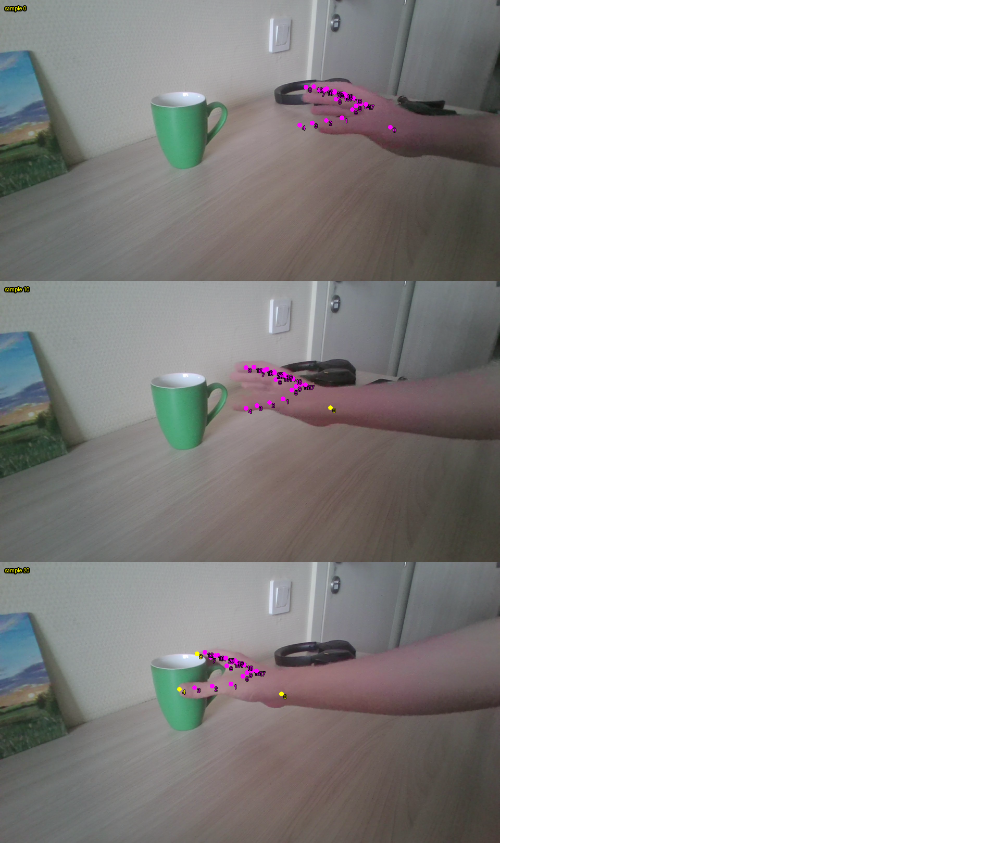
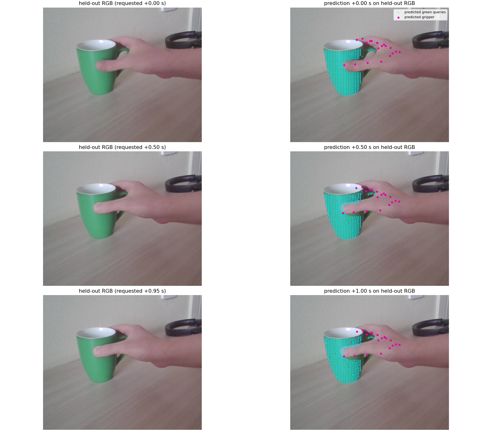
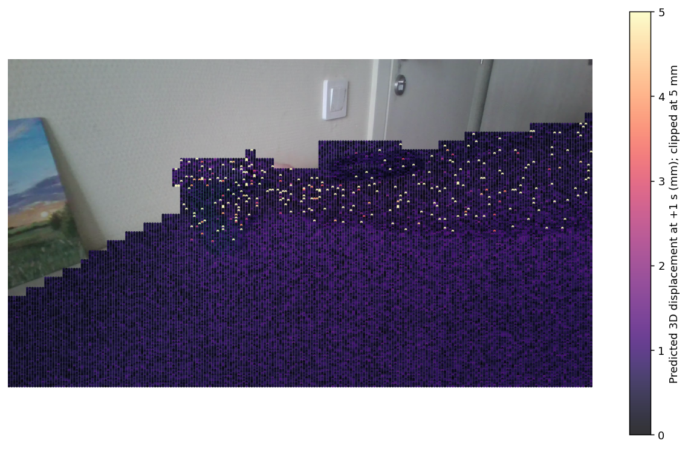

# Stage4: прогноз собственной сцены по одному RGB-видео

**Дата опыта:** 12 ноября 2026 года. **Статус:** один завершённый инференс UNITAS и качественное сравнение с отложенной секундой. Исходное видео, полный входной NPZ и полный прогноз сохранены локально; в Git включены этот отчёт и четыре иллюстрации. Численной оценки ошибки относительно 3D-эталона нет.

## Исследовательский вопрос

Проверялось, сможет ли готовая модель UNITAS SceneFlow принять сцену вне штатного набора LIBERO: настоящую зелёную кружку на столе и человеческую руку. Исходный материал — одно RGB-видео без измеренной глубины и параметров камеры. Сначала мультимодальная модель подготовила приближённую 3D-разметку по прошлым кадрам, затем готовая UNITAS предсказала следующую секунду движения захвата и сцены. Продолжение записи было отделено до подготовки входа и открыто только после сохранения прогноза.

Этот опыт проверяет техническую возможность такого прогона и наблюдаемую согласованность его результата с видео. Он не изолирует качество UNITAS от ошибок построения глубины и представления человеческой руки.

## Материал и граница прогноза

Исходный ролик `WIN_20261112_10_59_15_Pro.mp4`: 1920×1080, 15,68 с, сообщаемая частота 29,58 кадра/с. Из него последовательно просматривались кадры до **6,000 с**. Первым выбранным состоянием с секундой истории и различимым хватом стал момент 6,000 с. Входная история содержит 21 состояние на целевой сетке 20 Гц; реальные времена кадров лежат от 4,976033 до 5,984100 с, все 21 кадр различны. Целевое время и реальный PTS сохранены отдельно; кадры не выдавались за синтезированные наблюдения.

Следующий интервал `(6,000; 7,000]` с сохранён отдельно. Ни изображения этого интервала, ни аудио, ни отдельное JPG не использовались при разметке или выборе входа. Команда `Move the mug.` зафиксирована до его просмотра. Высоту кружки **0,11 м** сообщил пользователь; остальные метрические размеры оценивались моделью. GPS-метаданные исходного файла в отчёт не перенесены.

## Оценка сцены самой моделью

Первая, осторожная разметка `cup-001` покрывала 48 из 2304 ячеек карты глубины. После запроса пользователя сделана отдельная `cup-002` по **тем же** 21 кадрам и той же границе прогноза. Первая попытка сохранена; новая использовала прямой визуальный анализ и геометрические предположения для заполнения большего числа областей. Специальные модели оценки глубины, сегментации и распознавания руки не применялись. Сведения о том, что следует из наблюдения, и о том, что экстраполировано, записаны в исходном JSON.

| Величина | Оценка в `cup-002` | Основание и ограничение |
|---|---:|---|
| Внутренние параметры камеры | `fx=fy=1360 px`, `cx=960`, `cy=540` | Визуальная гипотеза; реальной калибровки нет |
| Дисторсия | принята нулевой | Допущение, не результат измерения |
| Опора масштаба | высота кружки 0,11 м | Измерение пользователя |
| Проекция высоты кружки | 293,4 px против приблизительно 295 px на кадре | Проверка согласованности выбранных K и положения, не независимая точность |
| Начало координат | под кружкой на оценённой плоскости стола | Выбранное соглашение собственной сцены |
| Вертикаль | нормаль оценённого стола `[0, −0,95, −0,31]` в системе камеры | Визуальная оценка наклона |
| Карта camera-z | 64×36, 1477/2304 ячеек заполнено (64,1%) | Стол экстраполирован как плоскость, объекты интерполированы по контурам; остальное неизвестно |
| Точки руки | 441/441 записей; 23 `visible`, 418 `inferred` | Почти вся траектория содержит предположения, особенно скрытые пальцы |
| Условная EEF | 21 поза | Центр хвата и раскрытие приближённы; единичный quaternion — соглашение, не измеренная ориентация кисти |

Белые области справа на схеме — отсутствие численной глубины. Поверхности стола и кружки получают `camera-z` в метрах; это **не** измеренный RGB-D. Линейная геометрия плоскости стола может давать гладкую карту и при ошибочном наклоне. Число 64,1% показывает полноту предположений, а не достоверность.

На кадрах истории 0, 10 и 20 точки в целом следуют за контуром руки. Плотные ряды розовых точек отражают восстановление скрытых суставов по анатомической непрерывности, а не видимость всех фаланг. В конце истории рука уже касается кружки. Области большого пальца, пальцев за кружкой и границы ручки остаются наиболее неопределёнными.

## Преобразование в интерфейс UNITAS

Технический помощник преобразовал оценки в формат, совместимый с LIBERO-входом SceneFlow. Исходная камера занимает `cam0`; `cam1` и `cam2` помечены отсутствующими. RGB уменьшен до 224×224, глубина перенесена на ту же сетку с маской неизвестных значений. 20 точек пальцев размещены в `history_robot_flows`, запястье сохранено отдельно. Один EEF-слот активен; другой отсутствует. Человеческие пальцы не являются геометрией обучающего захвата Panda, а условная EEF не восстанавливает суставные углы робота.

| Поле | Форма |
|---|---:|
| История точек захвата | `[1, 21, 20, 3]` |
| Маска существования точек | `[1, 21, 20]` |
| История поз EEF | `[1, 21, 2, 7]` |
| История раскрытия EEF | `[1, 21, 2, 1]` |
| Начальное облако запросов `xyz0` | `[32190, 3]` |
| Горизонт сцены, захвата и EEF | 20 шагов при 20 Гц |

Исходный `load_input` UNITAS загрузил NPZ; формы основных полей совпали с подготовленным примером LIBERO. Локальный валидатор дополнительно проверил временной порядок, постоянство идентификаторов и обратную проекцию. Остаток обратной проекции порядка `2,27×10⁻¹³` пикселя подтверждает согласованность записанных матриц и чисел. Он не подтверждает физическую калибровку камеры. SHA-256 входа: `6b865e89f5d9fdd8c75ca74d18f6210c42f73e143ae7aa0823c3b26931f59f3a`.

Полные локальные артефакты: `media_processing/prepared/cup-002/annotations.json`, `manifest.json`, `input.npz`, `input-provenance.json`, `report.md`. Они не входят в этот коммит, поскольку содержат данные собственной записи и нужны только для локального воспроизведения.

## Запуск готовой модели

[Notebook stage4](../../../src/stage4_own_scene/stage4.ipynb) получен копированием пяти ячеек stage2. Изменён только вход в последней ячейке и добавлена загрузка `input.npz`, если файла ещё нет в Colab. Фактический автоматический запуск выполнил эквивалентные пять шагов в отдельной Jupyter-сессии Colab; NPZ передан напрямую в runtime, личное полное видео в Colab не загружалось. В локальной копии авторского `inference.py` внутри Colab отключён BF16-autocast для FP32 на T4. Исходники UNITAS в проекте остались прежними.

| Параметр | Значение |
|---|---|
| Устройство | Colab Tesla T4 |
| Python / PyTorch / Transformers / NumPy | 3.10.22 / 2.5.1+cu121 / 4.57.1 / 1.26.4 |
| Ревизия UNITAS | `c92ee809abd2862a911c61d4b19389308f7eb57e` |
| SHA-256 SceneFlow checkpoint | `49c44021c9e32ac7ccf7d69eabeaab0f7480a383a19955d4803d4fc52352b71b` |
| SHA-256 Florence model.safetensors | `4f38ce741c6b71188fe2b3419a55e11917a8a7b321ae2e63c61da0191b0ebad7` |
| Диффузия и порции | 10 шагов, chunk-size 256 |
| Seed | policy 42; scene 210921 |
| Временной горизонт | 20 шагов / 20 Гц = 1,0 с |
| Длительность и результат процесса | 203,075 с; код возврата 0 |

Модель сохранила `scene` `[21,32190,3]`, `gripper` `[21,20,3]`, `eef_poses` `[20,2,7]`, `eef_open` `[20,2,1]`. Все координаты конечны; первый кадр `scene` точно равен `xyz0`. SHA-256 прогноза: `15518597a1136fb351a32f44c8114e1bac5957eeaf17dea17ee4e746ee91112e`. В журнале есть предупреждение Florence о вновь инициализированном `embed_tokens.weight`; запуск завершился успешно, влияние предупреждения на этот опыт не проверено. После сохранения результатов сессия Colab закрыта.

Полный прогноз и журнал находятся локально в `outputs/stage4/cup-002/scene_flow.npz` и `run.log`. [Скрипт сравнения](../../../src/stage4_own_scene/compare_heldout.py) воспроизводит проекции и численную сводку при наличии этих локальных артефактов и извлечённых отложенных кадров.

## Сопоставление с отложенной секундой

Только после успешного сохранения `scene_flow.npz` были открыты три кадра отложенного видео с запрошенными смещениями 0, 0,5 и 0,95 с. Для них использована неподвижная, **оценённая** камера из входа. Визуализация сравнивает выходные шаги 0, 10 и 20. Последняя пара имеет расхождение запрошенных времён 0,05 с: предсказание для +1,00 с наложено на кадр около +0,95 с.

Слева показан реальный RGB, справа тот же кадр с проекцией прогноза. Голубые точки — 816 query-точек, которые были зелёными в исходном RGB по простому правилу `G>1,25R`, `G>1,1B`, `G>50`. Это диагностический цветовой отбор, не эталонная сегментация кружки. Розовые точки — 20 предсказанных точек захвата. Их расположение около руки и попадание голубого облака на видимую часть кружки показывают 2D-согласованность для выбранных кадров. Они не раскрывают глубину невидимой стороны кружки или фактический контакт.

На трёх отложенных кадрах рука продолжает удерживать кружку у поверхности стола. Явного подъёма или переноса за эту секунду нет. Прогноз также оставляет большую часть зелёных точек почти на месте. Это ограниченная проверка **удержания почти статичной сцены**. Заявлять успех на задаче переноса кружки по ней нельзя.

| Группа предсказанных точек, шаг 20 | Медиана смещения от шага 0 | 95-й процентиль | Максимум |
|---|---:|---:|---:|
| Все 32 190 точек | 0,56 мм | 1,04 мм | 60,6 мм |
| 816 исходно зелёных точек | 0,53 мм | 1,11 мм | 16,2 мм |

Светлые редкие точки на карте показывают выбросы прогноза; цветовая шкала обрезана на 5 мм, тогда как численный максимум выше. Таблица отражает **перемещение в самом прогнозе**, а не ошибку относительно реальности. При отсутствии эталонных 3D-соответствий назвать эти значения ADE или FDE нельзя. Крупные области столешницы получены экстраполяцией плоскости, поэтому их небольшое предсказанное движение не доказывает точности физики стола.

Условный показатель раскрытия активного EEF в выходе меняется приблизительно от 0,088 до 0,354. На выбранных RGB-кадрах человеческая рука всё ещё находится на кружке. Это возможное расхождение представления действия, но прямого метрического соответствия между выходным `eef_open` роботического интерфейса и видимым раскрытием человеческих пальцев нет; утверждать ошибку хвата по одному числу нельзя.

## Что удалось установить и что остаётся открытым

**Установлено:** готовый SceneFlow pipeline обработал контейнер с одной действующей камерой, оценённой глубиной и историей человеческой руки без ошибки исполнения. Прогноз и исходный NPZ сохранены с контрольными суммами. В выбранную почти статичную секунду проекции предсказанных точек кружки качественно согласуются с отложенным RGB.

**Не установлено:** физическая точность K, глубины и положения стола; истинная 3D-траектория точек кружки; переносимость кинематики и захвата Panda на человеческую кисть; способность UNITAS предсказывать подъём или перенос в этой собственной сцене. 418 из 441 положений руки являются предположениями. Ошибки подготовки входа и ошибки самой UNITAS по одному такому ролику разделить нельзя. 3D ADE/FDE и успешность задачи не рассчитывались.

Следующая исследовательская проверка потребовала бы независимой глубины или калибровки и фрагмента с заметным будущим движением, выбранного до просмотра продолжения. Этот опыт менять задним числом не нужно: его фиксированная граница и спокойный отложенный интервал остаются частью результата.
